


  
  



### ❯ stack

  

### ❯ projets

  <a href="https://github.com/Ushxo/archipel-releases"></a>
  

### ❯ stats

  
  

  

  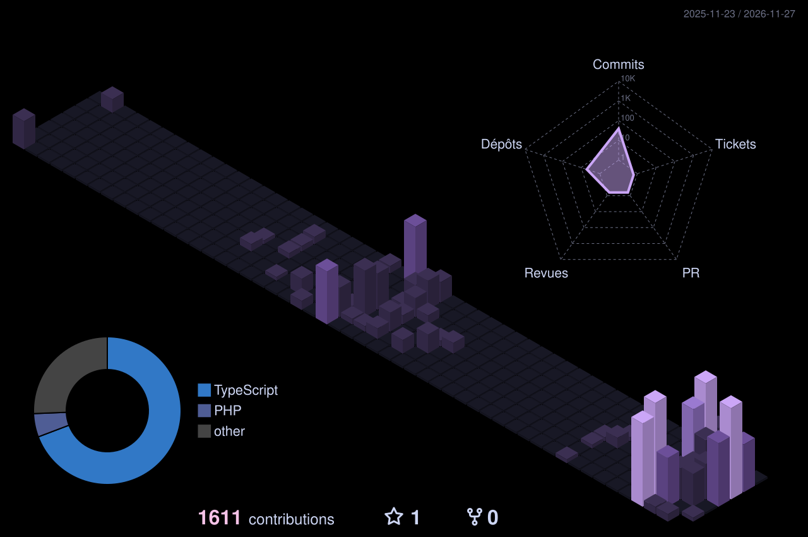

  <picture>
    <source media="(prefers-color-scheme: dark)" srcset="https://raw.githubusercontent.com/Ushxo/Ushxo/output/serpent-sombre.svg" />
    <source media="(prefers-color-scheme: light)" srcset="https://raw.githubusercontent.com/Ushxo/Ushxo/output/serpent-clair.svg" />
    
  </picture>

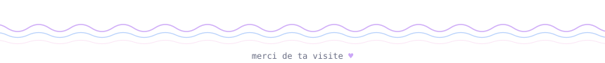
